# Архитектура системы JDX и план внедрения AI
> Система учёта лабораторных испытаний на платформе Data Express с интеграцией искусственного интеллекта

**Версия документа:** 2.0  
**Дата:** 28 октября 2026  
**Платформа:** Data Express (mydataexpress.ru)  
**СУБД:** Firebird 5.0  
**Язык скриптов:** RemObjects Pascal Script  
**Автор:** Cordek

---

## 📋 Содержание

### Часть I. Архитектура системы JDX

1. [Введение](#1-введение)
2. [Обзор системы](#2-обзор-системы)
3. [C4-модель архитектуры](#3-c4-модель-архитектуры)
4. [Модель данных](#4-модель-данных)
5. [Инфраструктура и развёртывание](#5-инфраструктура-и-развёртывание)
6. [Сетевые правила и безопасность](#6-сетевые-правила-и-безопасность)
7. [Структура хранения данных](#7-структура-хранения-данных)

### Часть II. AI-интеграция

8. [Архитектура хранения данных и метаданных для AI](#8-архитектура-хранения-данных-и-метаданных-для-ai)
9. [Ручное редактирование метаданных](#9-ручное-редактирование-метаданных)
10. [Редактирование метаданных с помощью AI агента](#10-редактирование-метаданных-с-помощью-ai-агента)
11. [AI агент как исполнитель процессов](#11-ai-агент-как-исполнитель-процессов)
12. [Использование AI агентом данных из базы](#12-использование-ai-агентом-данных-из-базы)
13. [Интеграционная архитектура AI](#13-интеграционная-архитектура-ai)
14. [Безопасность и контроль AI-действий](#14-безопасность-и-контроль-ai-действий)

### Часть III. План внедрения AI

15. [План внедрения AI в систему JDX](#15-план-внедрения-ai-в-систему-jdx)
16. [Приложения](#16-приложения)

---

# ЧАСТЬ I. АРХИТЕКТУРА СИСТЕМЫ JDX

---

## 1. Введение

### 1.1 Назначение документа
Документ описывает архитектуру системы **JDX** — конфигурации на платформе Data Express для автоматизации учёта лабораторных испытаний, управления документами системы менеджмента качества (СМК) и сопутствующих процессов лаборатории, а также план внедрения AI-агента для расширения функциональности системы.

### 1.2 Область применения
- Лабораторный учёт образцов и результатов испытаний
- Управление методиками, оборудованием, персоналом
- Документооборот СМК: аудиты, оценки рисков, корректирующие действия
- Формирование протоколов и отчётности
- AI-ассистированная разработка и выполнение процессов

### 1.3 Технологический стек

| Компонент | Технология | Версия |
|-----------|-----------|--------|
| Платформа | Data Express | - |
| СУБД | Firebird | 5.0 |
| Язык скриптов | RemObjects Pascal Script | - |
| Толстый клиент | Windows App | - |
| Веб-клиент | Browser (HTTP/HTTPS) | - |
| Интеграции | REST API (модуль в разработке) | - |

---

## 2. Обзор системы

**JDX** — модульная система учёта, построенная на low-code платформе Data Express. Система поддерживает два типа клиентов:
- **Толстый клиент** — основной интерфейс для работы внутри защищённого контура лаборатории
- **Веб-клиент** — упрощённый доступ для внешних пользователей через защищённый шлюз

**Ключевые возможности:**
- Регистрация и отслеживание образцов
- Ввод и валидация результатов испытаний
- Управление нормативной базой (методики, ГОСТы)
- Учёт оборудования и графиков поверки
- Документооборот СМК (аудиты, риски, корректирующие действия)
- Формирование печатных форм протоколов

---

## 3. C4-модель архитектуры

### 3.1 System Context (Уровень 1)

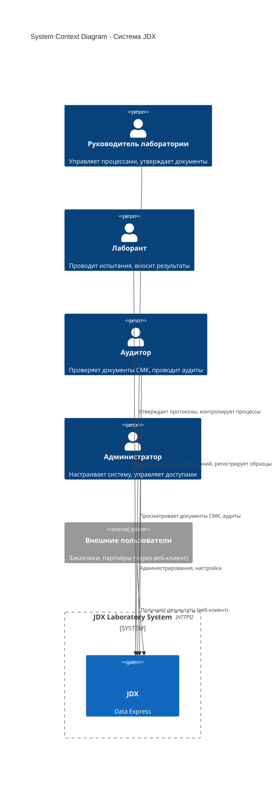

### 3.2 Container Diagram (Уровень 2)

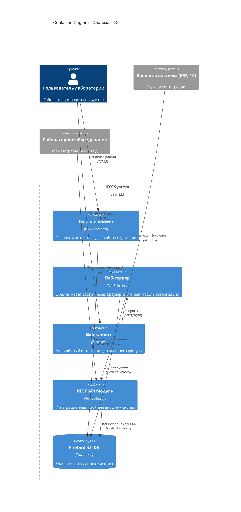

### 3.3 Component Diagram — Толстый клиент (Уровень 3)

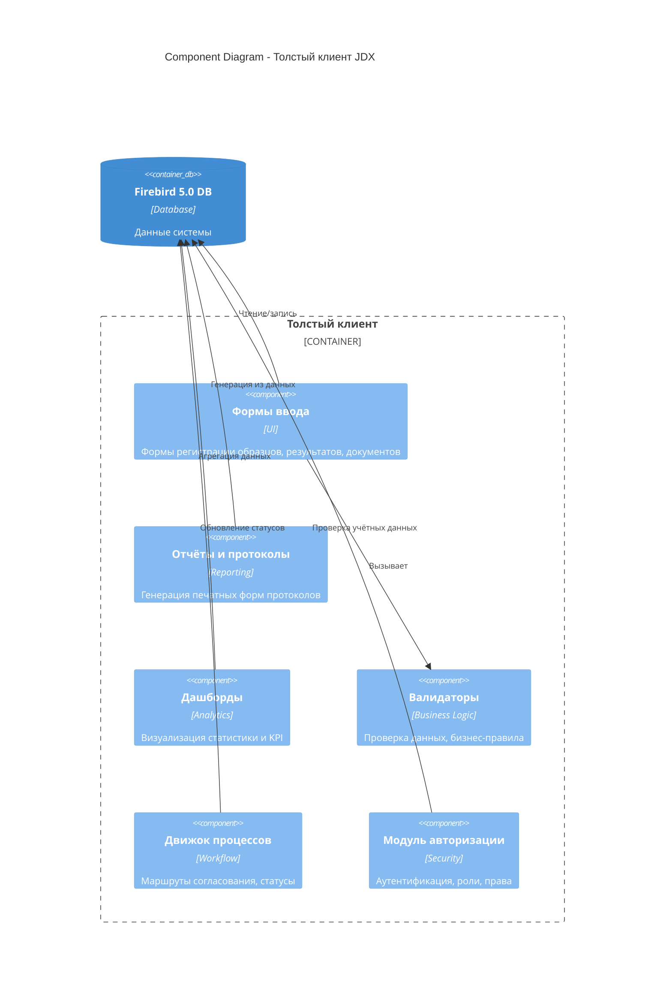

### 3.4 Component Diagram — REST API Модуль (Уровень 3)

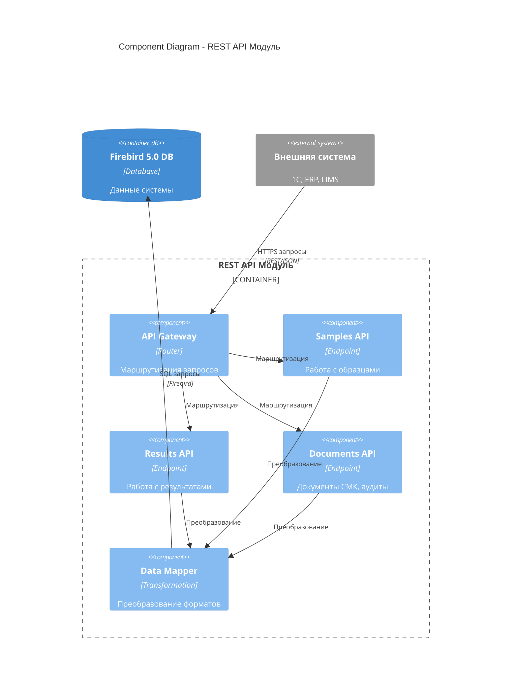

---

## 4. Модель данных

### 4.1 ER-диаграмма основных сущностей

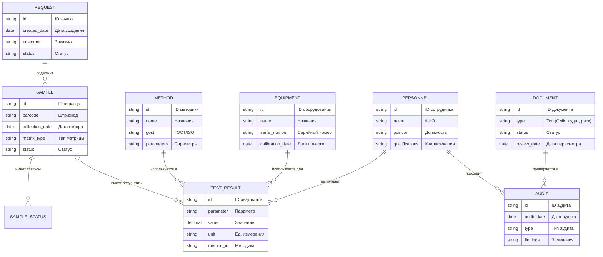

---

## 5. Инфраструктура и развёртывание

### 5.1 Сценарий А: Закрытый контур

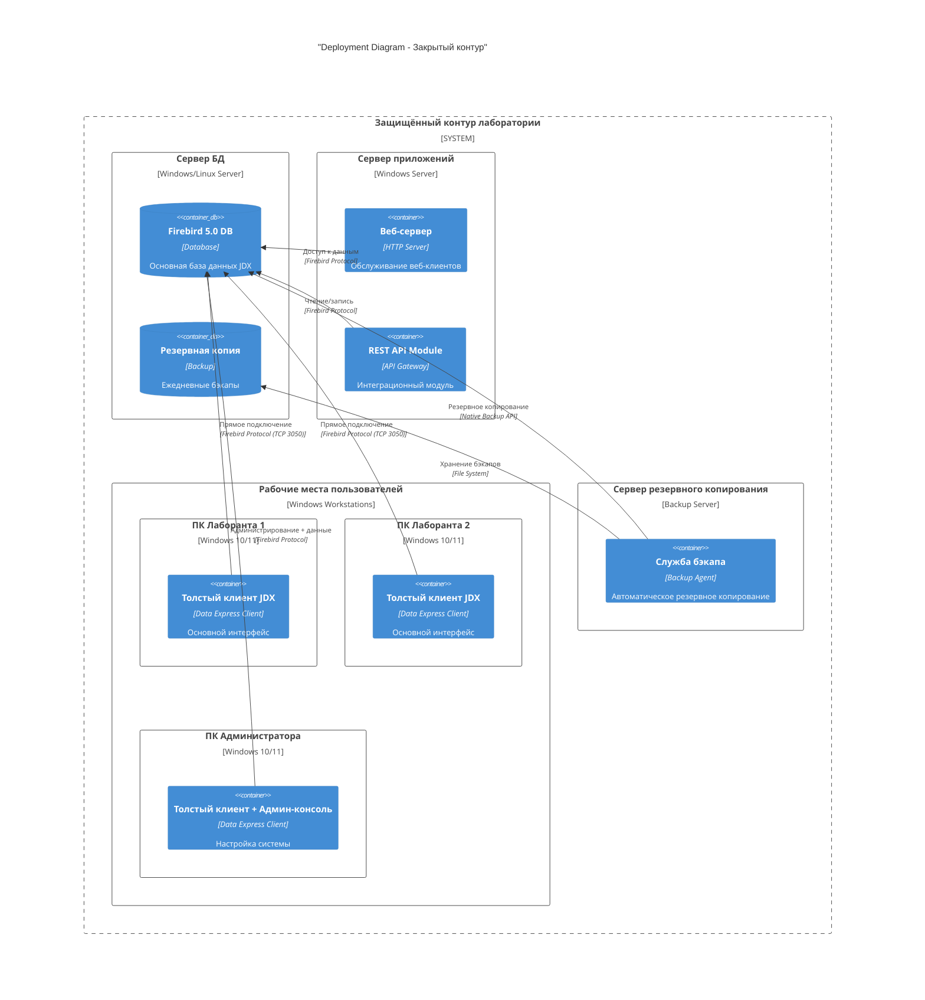

### 5.2 Сценарий Б: Гибридный доступ с DMZ

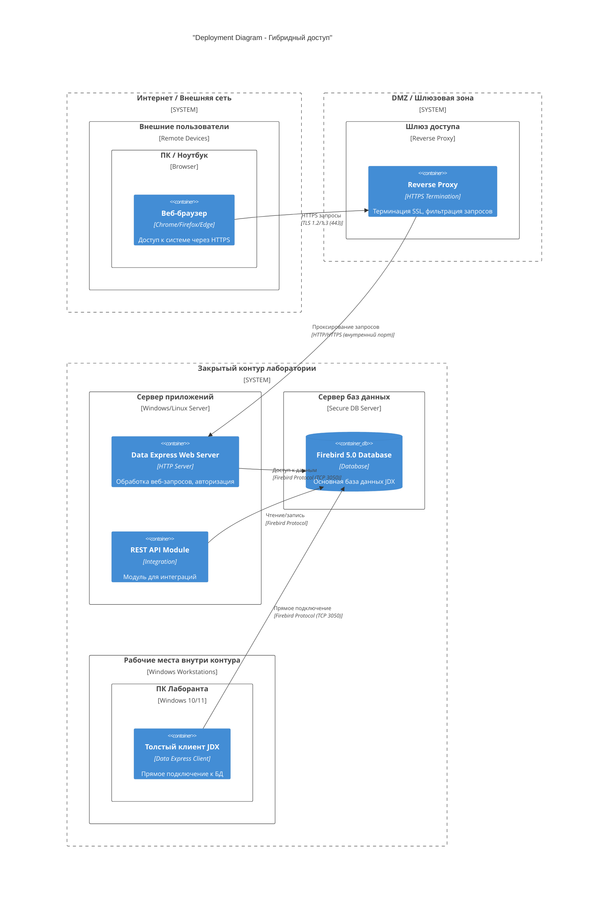

### 5.3 Поток запроса внешнего пользователя

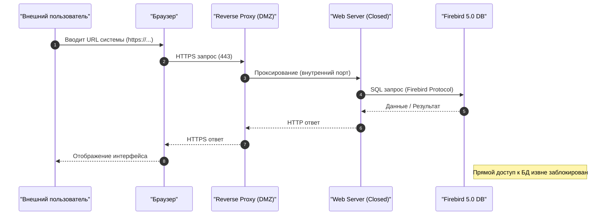

---

## 6. Сетевые правила и безопасность

### 6.1 Матрица сетевых правил (Firewall)

| Источник | Назначение | Порт | Протокол | Действие |
|----------|-----------|------|----------|----------|
| Интернет | DMZ: Reverse Proxy | 443/TCP | HTTPS | ALLOW |
| Интернет | DMZ: Reverse Proxy | 80/TCP | HTTP | REDIRECT→443 |
| DMZ: Proxy | Closed: Web Server | 8080/TCP | HTTP | ALLOW |
| DMZ: Proxy | Closed: Firebird DB | 3050/TCP | Firebird | DENY |
| Closed: Thick Client | Closed: Firebird DB | 3050/TCP | Firebird | ALLOW |
| Closed: Web Server | Closed: Firebird DB | 3050/TCP | Firebird | ALLOW |
| Интернет | Closed: Любые ресурсы | Любой | Любой | DENY |
| Management | Все серверы | 22/3389 | SSH/RDP | ALLOW* |

> *Доступ для администрирования только с выделенных управляющих станций через VPN.

### 6.2 Рекомендации по безопасности

**Обязательные меры:**
1. Запретить прямой доступ к порту 3050 (Firebird) из любой сети, кроме доверенных внутренних сегментов
2. Использовать Reverse Proxy как единственную точку входа извне
3. Включить аудит подключений и изменений в базе данных
4. Регулярно обновлять платформу Data Express и СУБД Firebird 5.0

**Рекомендуемые меры:**
1. Выделить отдельный домен для внешнего доступа (например, `ext.jdx.lab.ru`)
2. Настроить принудительное использование HTTPS с TLS 1.2+
3. Ограничить время сессии и реализовать автоматический выход при неактивности
4. Вести централизованный журнал событий безопасности

---

## 7. Структура хранения данных

### 7.1 Три зоны данных в СУБД Firebird 5.0

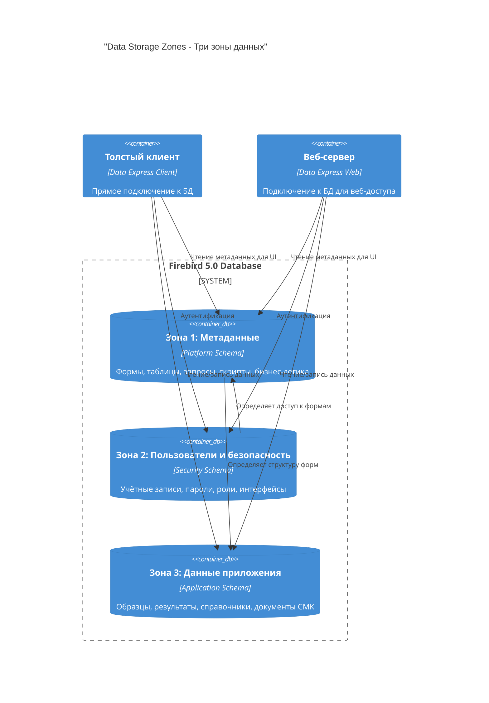

### 7.2 Детальное описание зон

#### Зона 1: Метаданные (Platform Metadata)

| Компонент | Описание |
|-----------|----------|
| Формы ввода | Описание форм для ввода информации |
| Таблицы просмотра | Конфигурация таблиц для отображения данных |
| Запросы | SQL-запросы для выборки данных |
| Бизнес-логика | Скрипты, модули, валидаторы на RemObjects Pascal Script |

**Важно:** Справочники **НЕ входят** в метаданные — они относятся к данным приложения (Зона 3).

#### Зона 2: Пользователи и безопасность (Security)

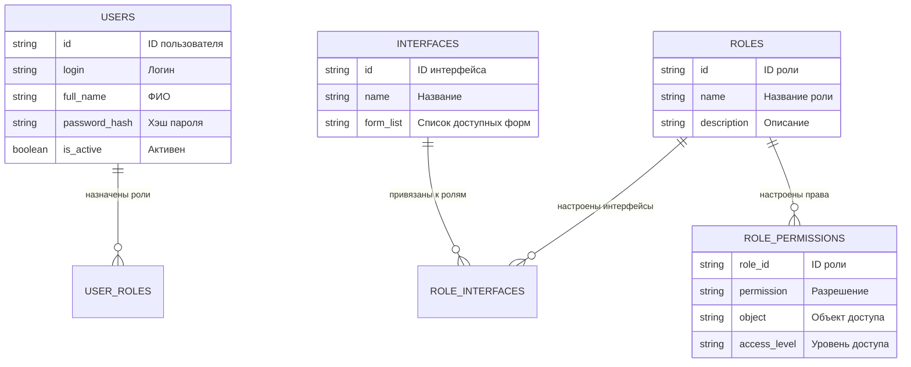

**Схема доступа:** `Пользователь → Роли → Интерфейсы → Формы/Данные`

#### Зона 3: Данные приложения (Application Data)

| Компонент | Описание |
|-----------|----------|
| Лабораторные данные | Образцы, результаты, заявки |
| Справочники (НСИ) | Основные справочники системы |
| Нормативная база | Методики, ГОСТы, параметры |
| Ресурсы | Оборудование, персонал, реактивы |
| Документы СМК | Аудиты, риски, корректирующие действия |

### 7.3 Процесс авторизации и загрузки интерфейса

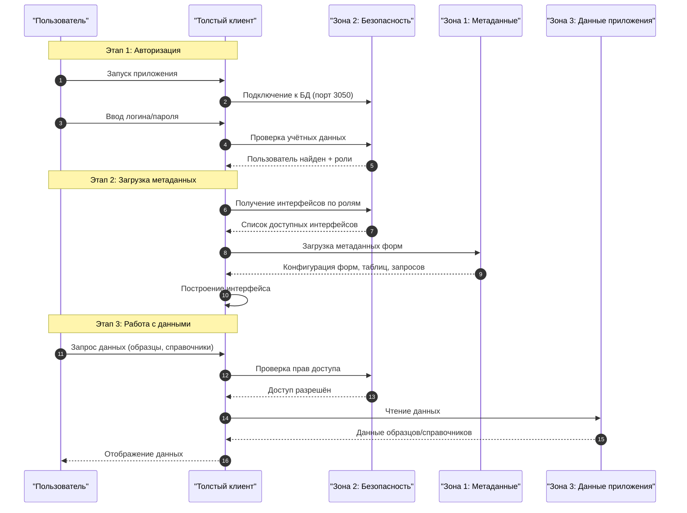

### 7.4 Варианты развёртывания зон данных

| Критерий | Единая БД | Разнесённые БД |
|----------|-----------|----------------|
| Сложность развёртывания | Низкая | Высокая |
| Производительность | Выше (одно подключение) | Ниже (множественные подключения) |
| Масштабируемость | Ограничена | Высокая |
| Резервное копирование | Единый бэкап | Раздельные бэкапы |
| Целостность данных | Гарантирована транзакциями | Требует синхронизации |
| Подключений к БД | Одно на клиент | Три на клиент |
| Рекомендуемый размер | До 100 пользователей | 100+ пользователей |
| **Для JDX** | **✅ Рекомендуется** | ⚠️ При росте |

---

# ЧАСТЬ II. AI-ИНТЕГРАЦИЯ

---

## 8. Архитектура хранения данных и метаданных для AI

### 8.1 Четыре логических слоя данных

**Метаданные** — конфигурация системы в текстовом формате:
- Формы ввода (описание полей, типов данных, валидации)
- Таблицы просмотра (конфигурация списков, колонок, фильтров)
- Запросы (SQL для выборки данных)
- Скрипты и модули (код на RemObjects Pascal Script)
- Валидаторы (правила проверки данных)

**Рабочие данные** — операционная информация:
- Заявки на испытания, образцы, результаты анализов, протоколы

**НСИ** — нормативно-справочная информация:
- Методики испытаний, ГОСТы, типы образцов, единицы измерения, классификаторы

**Знания** — экспертная информация:
- Описание методик, правила интерпретации, критерии приёмки, исторические прецеденты

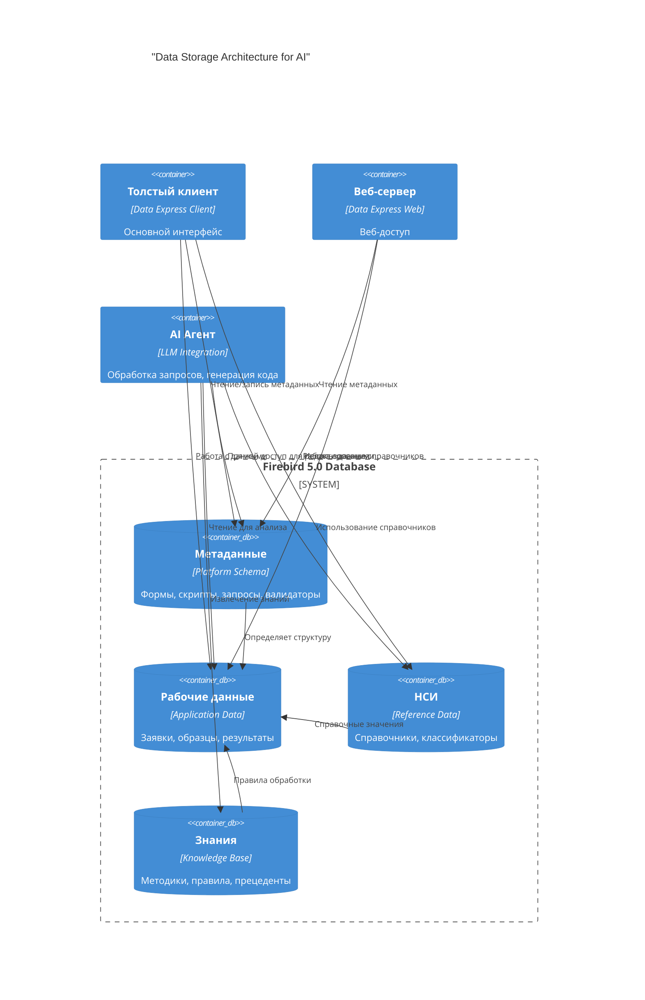

### 8.2 Обращение к данным

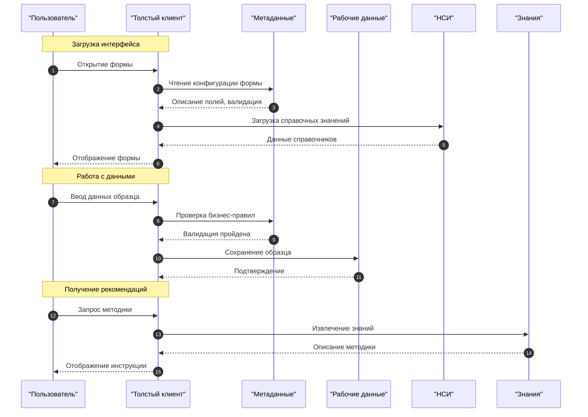

---

## 9. Ручное редактирование метаданных

### 9.1 Два метода редактирования

**Визуальный конструктор (UI/UX)** — для настройки:
- Структуры форм (добавление полей, вкладок, групп)
- Таблиц просмотра (настройка колонок, фильтров, сортировки)
- Связей между объектами
- Маршрутов бизнес-процессов

**Текстовый редактор** — для:
- Написания скриптов на RemObjects Pascal Script
- Создания модулей и расширений
- Настройки валидаторов
- Модификации SQL-запросов

Прямой ввод текста доступен **только для кода**. Конфигурация интерфейсов настраивается исключительно через конструктор.

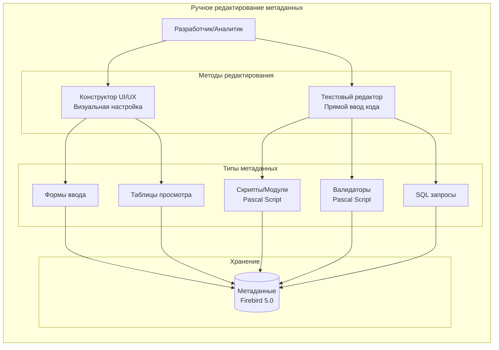

### 9.2 Процесс ручного редактирования

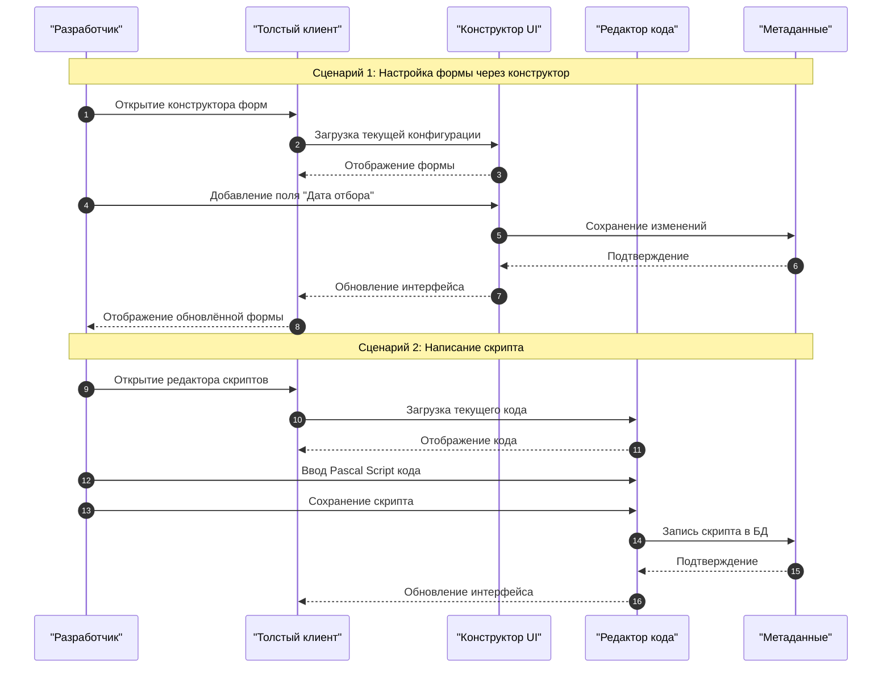

---

## 10. Редактирование метаданных с помощью AI агента

### 10.1 Возможности AI агента

**Генерация кода:**
- Новые скрипты на RemObjects Pascal Script на основе описания задачи
- Модификации существующих модулей
- Валидаторы с заданными правилами
- SQL-запросы для выборки данных

**Контекстная генерация:**
- Чтение текущих метаданных для понимания структуры
- Анализ связанных объектов и зависимостей
- Учёт существующих паттернов кода Pascal Script
- Предложение изменений с учётом контекста

**Безопасность изменений:**
- Валидация перед сохранением
- Ручное подтверждение разработчиком
- Версионирование для возможности отката
- Логирование в аудите изменений

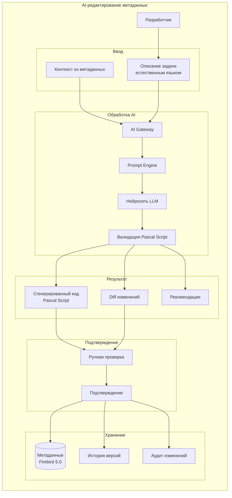

### 10.2 Процесс AI-редактирования

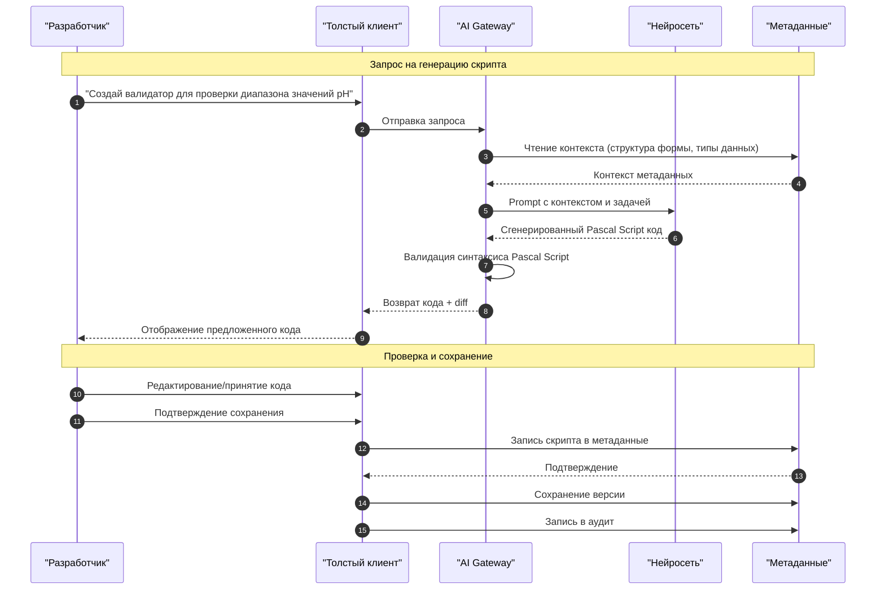

### 10.3 Пример генерации кода

**Запрос:** "Создай валидатор, который проверяет, что значение pH находится в диапазоне от 0 до 14"

**Сгенерированный код на Pascal Script:**
```pascal
function ValidatePH(Value: Variant): Boolean;
var
  PHValue: Double;
begin
  Result := False;
  
  if VarIsNull(Value) or VarIsEmpty(Value) then
  begin
    ShowMessage('Значение pH не может быть пустым');
    Exit;
  end;
  
  try
    PHValue := StrToFloat(VarToStr(Value));
  except
    on E: Exception do
    begin
      ShowMessage('Значение pH должно быть числом');
      Exit;
    end;
  end;
  
  if (PHValue < 0) or (PHValue > 14) then
  begin
    ShowMessage('Значение pH должно быть в диапазоне от 0 до 14');
    Exit;
  end;
  
  Result := True;
end;
```

---

## 11. AI агент как исполнитель процессов

### 11.1 Функции AI агента

**Автоматическое заполнение форм:**
- Анализ входных данных (описание образца, результаты измерений)
- Извлечение структурированной информации из неструктурированного текста
- Заполнение полей формы автоматически
- Предложение значений на основе контекста

**Обработка заявок:**
- Классификация входящих заявок по типу
- Определение необходимых методик испытаний
- Распределение задач между лаборантами
- Отслеживание статусов и сроков

**Валидация данных:**
- Проверка результатов на соответствие методикам
- Выявление аномалий и потенциальных ошибок
- Предложение корректировок или повторных измерений

**Консультирование:**
- Ответы на вопросы о методиках
- Подсказки по последовательности действий
- Объяснение причин ошибок валидации

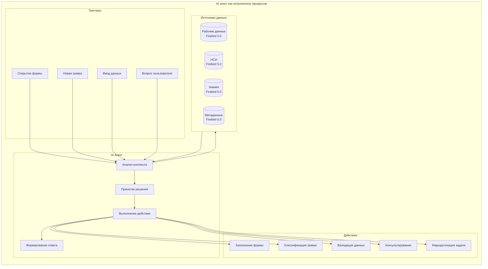

### 11.2 Процесс выполнения AI агентом

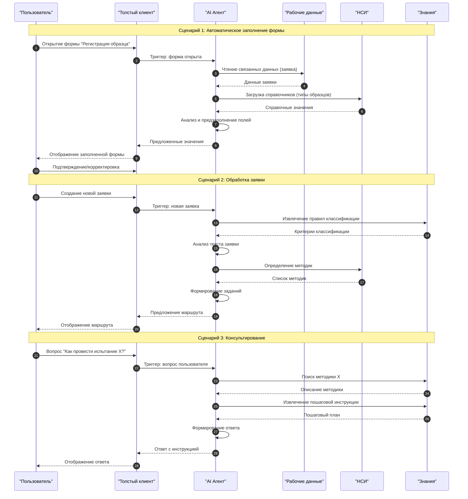

---

## 12. Использование AI агентом данных из базы

### 12.1 Источники данных для AI агента

**Рабочие данные:**
- История образцов и результатов для анализа трендов
- Сравнение текущих результатов с предыдущими измерениями
- Выявление отклонений и аномалий
- Прогноз сроков выполнения на основе загруженности

**НСИ:**
- Справочники для валидации введённых данных
- Классификаторы для категоризации объектов
- Сопоставление типов образцов с методиками
- Проверка единиц измерения и диапазонов

**Знания:**
- Методики для консультирования пользователей
- Правила интерпретации результатов
- Критерии приёмки/браковки
- Исторические прецеденты

**Метаданные:**
- Структура форм для понимания контекста
- Бизнес-логика на Pascal Script
- Валидаторы для проверки данных
- Конфигурация для модификации

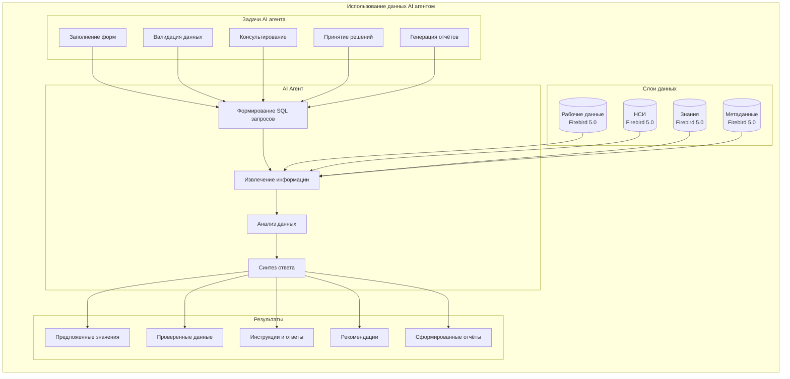

### 12.2 Процесс извлечения и использования данных

```mermaid
sequenceDiagram
    autonumber
    participant Task as "Задача"
    participant AI as "AI Агент"
    participant Op as "Рабочие данные"
    participant NSI as "НСИ"
    participant Know as "Знания"
    participant Meta as "Метаданные"

    Note over Task, Meta: Задача: Валидация результата испытания
    
    Task->>AI: "Проверь результат: pH = 7.2 для воды питьевой"
    AI->>Meta: Чтение структуры данных (тип образца)
    Meta-->>AI: Тип: "Вода питьевая"
    AI->>NSI: Загрузка нормативов для воды
    NSI-->>AI: Норма pH: 6.0-9.0
    AI->>Op: Чтение истории результатов (контекст)
    Op-->>AI: Последние 5 измерений: 7.1, 7.3, 7.0, 7.2, 7.4
    AI->>Know: Извлечение правил интерпретации
    Know-->>AI: Правила: стабильность ±0.5, тренд
    AI->>AI: Анализ: 7.2 в норме, стабильно, без аномалий
    AI-->>Task: "Результат корректен. pH=7.2 в пределах нормы (6.0-9.0). Тренд стабильный."

    Note over Task, Meta: Задача: Рекомендация методики
    
    Task->>AI: "Какая методика для определения тяжёлых металлов в почве?"
    AI->>NSI: Поиск по типу образца "Почва"
    NSI-->>AI: Найдено: 3 методики
    AI->>Know: Загрузка описаний методик
    Know-->>AI: Методики: ААС, ICP-MS, XRF
    AI->>Op: Анализ исторических данных (что использовали)
    Op-->>AI: Частота: ICP-MS 70%, ААС 25%, XRF 5%
    AI->>Know: Извлечение критериев выбора
    Know-->>AI: Критерии: точность, стоимость, время
    AI->>AI: Синтез рекомендации
    AI-->>Task: "Рекомендую ICP-MS (используется в 70% случаев). Альтернатива: ААС для простых задач."
```

---

## 13. Интеграционная архитектура AI

### 13.1 Общая схема интеграции

```mermaid
C4Container
    title "AI Agent Integration Architecture"

    Person(user, "Пользователь", "Лаборант, руководитель")
    Person(dev, "Разработчик", "Настройка конфигурации")

    System_Boundary(jdx_system, "JDX System") {
        Container(thick_client, "Толстый клиент", "Data Express Client", "Основной интерфейс")
        Container(ai_gateway, "AI Gateway", "Integration Layer", "Управление AI-запросами")
        Container(process_engine, "Процессный движок", "Workflow Engine", "Выполнение бизнес-процессов")
        ContainerDb(metadata, "Метаданные", "Firebird 5.0", "Конфигурация системы, Pascal Script")
        ContainerDb(operational, "Рабочие данные", "Firebird 5.0", "Операционные данные")
        ContainerDb(nsi, "НСИ", "Firebird 5.0", "Справочники")
        ContainerDb(knowledge, "Знания", "Firebird 5.0", "Методики, правила")
    }

    System_Ext(llm, "Нейросеть", "LLM API", "GPT/Claude/локальная модель")

    Rel(user, thick_client, "Работа с системой")
    Rel(dev, thick_client, "Настройка конфигурации")
    
    Rel(thick_client, ai_gateway, "AI-запросы")
    Rel(ai_gateway, llm, "API вызовы", "HTTPS/REST")
    
    Rel(ai_gateway, metadata, "Чтение/запись метаданных")
    Rel(ai_gateway, operational, "Чтение данных")
    Rel(ai_gateway, nsi, "Использование справочников")
    Rel(ai_gateway, knowledge, "Извлечение знаний")
    
    Rel(process_engine, ai_gateway, "Вызов AI для процессов")
    Rel(process_engine, operational, "Обновление данных")
    
    Rel(thick_client, metadata, "Чтение конфигурации")
    Rel(thick_client, operational, "Работа с данными")
```

### 13.2 Компоненты AI Gateway

```mermaid
C4Component
    title "Component Diagram - AI Gateway"

    Container_Boundary(ai_gateway, "AI Gateway") {
        Component(prompt_engine, "Prompt Engine", "Template Manager", "Формирование запросов к LLM")
        Component(context_loader, "Context Loader", "Data Fetcher", "Загрузка контекста из метаданных")
        Component(code_parser, "Code Parser", "Validator", "Проверка сгенерированного Pascal Script")
        Component(diff_viewer, "Diff Viewer", "UI Component", "Отображение изменений в коде")
        Component(version_ctrl, "Version Control", "History", "Версионирование изменений метаданных")
    }

    System_Ext(llm_api, "LLM API", "External Service", "GPT/Claude/локальная модель")
    Container(script_editor, "Редактор скриптов", "Text Editor", "В толстом клиенте")
    ContainerDb(metadata_db, "Метаданные", "Firebird 5.0", "Хранение скриптов и модулей")

    Rel(prompt_engine, context_loader, "Запрашивает контекст")
    Rel(context_loader, metadata_db, "Чтение текущих метаданных")
    Rel(prompt_engine, llm_api, "Отправка prompt", "HTTPS/REST")
    Rel(llm_api, prompt_engine, "Возврат сгенерированного кода")
    Rel(code_parser, prompt_engine, "Валидация кода")
    Rel(diff_viewer, script_editor, "Интеграция в UI")
    Rel(version_ctrl, metadata_db, "Сохранение версий")
```

### 13.3 Поток данных при различных сценариях

```mermaid
flowchart LR
    subgraph Scenarios ["Сценарии использования"]
        S1[Редактирование метаданных]
        S2[Выполнение процессов]
        S3[Консультирование]
    end

    subgraph Data_Flow ["Поток данных"]
        direction TB
        
        subgraph Input ["Вход"]
            I1[Запрос пользователя]
            I2[Триггер процесса]
            I3[Событие в системе]
        end
        
        subgraph AI_Processing ["Обработка AI"]
            P1[Извлечение контекста]
            P2[Запрос к LLM]
            P3[Анализ ответа]
        end
        
        subgraph Data_Access ["Доступ к данным"]
            D1[Чтение метаданных]
            D2[Чтение рабочих данных]
            D3[Чтение НСИ]
            D4[Чтение знаний]
        end
        
        subgraph Output ["Выход"]
            O1[Изменённые метаданные]
            O2[Заполненные формы]
            O3[Ответы пользователю]
            O4[Рекомендации]
        end
    end

    S1 --> I1
    S2 --> I2
    S3 --> I3
    
    I1 --> P1
    I2 --> P1
    I3 --> P1
    
    P1 --> D1
    P1 --> D2
    P1 --> D3
    P1 --> D4
    
    D1 --> P2
    D2 --> P2
    D3 --> P2
    D4 --> P2
    
    P2 --> P3
    P3 --> O1
    P3 --> O2
    P3 --> O3
    P3 --> O4
```

---

## 14. Безопасность и контроль AI-действий

### 14.1 Схема контроля

```mermaid
flowchart TD
    subgraph AI_Control ["Контроль AI-действий"]
        direction TB
        
        subgraph Input_Validation ["Валидация входа"]
            IV1[Проверка запроса]
            IV2[Санитизация данных]
            IV3[Проверка прав доступа]
        end
        
        subgraph AI_Processing ["Обработка"]
            AP1[Формирование prompt]
            AP2[Вызов LLM]
            AP3[Парсинг ответа]
        end
        
        subgraph Output_Validation ["Валидация выхода"]
            OV1[Проверка синтаксиса Pascal Script]
            OV2[Тестирование в песочнице]
            OV3[Ручное подтверждение]
        end
        
        subgraph Audit ["Аудит"]
            AU1[Логирование запросов]
            AU2[Логирование изменений]
            AU3[Версионирование]
        end
    end

    IV1 --> IV2
    IV2 --> IV3
    IV3 --> AP1
    AP1 --> AP2
    AP2 --> AP3
    AP3 --> OV1
    OV1 --> OV2
    OV2 --> OV3
    OV3 --> AU1
    AU1 --> AU2
    AU2 --> AU3
```

### 14.2 Матрица безопасности

| Действие AI | Уровень риска | Меры контроля | Статус |
|-------------|---------------|---------------|--------|
| Чтение метаданных | Низкий | Аудит запросов | Обязательно |
| Чтение рабочих данных | Средний | Проверка прав доступа | Обязательно |
| Генерация Pascal Script | Высокий | Валидация синтаксиса + ручное подтверждение | Обязательно |
| Изменение метаданных | Критический | Тестирование + версионирование + откат | Обязательно |
| Заполнение форм | Средний | Валидация результатов | Обязательно |
| Консультирование | Низкий | Проверка источников | Рекомендуется |

### 14.3 Особенности валидации Pascal Script

**Проверка синтаксиса:**
- Компиляция в изолированной среде
- Проверка типов данных
- Валидация вызовов API платформы
- Проверка доступа к переменным

**Ограничения безопасности:**
- Запрет прямого доступа к файловой системе
- Ограничение вызовов внешних библиотек
- Контроль доступа к системным функциям
- Песочница для выполнения сгенерированного кода

---

# ЧАСТЬ III. ПЛАН ВНЕДРЕНИЯ AI

---

## 15. План внедрения AI в систему JDX

### 15.1 Цели внедрения

**Стратегические цели:**
1. Сокращение времени разработки конфигурации JDX на 40-60%
2. Автоматизация рутинных операций лаборантов
3. Повышение качества данных за счёт AI-валидации
4. Создание интеллектуального помощника для пользователей

**Тактические цели:**
- Внедрить AI-ассистент для генерации Pascal Script
- Автоматизировать заполнение типовых форм
- Реализовать AI-консультирование по методикам
- Настроить автоматическую классификацию заявок

### 15.2 Фазы внедрения

```mermaid
gantt
    title "План внедрения AI в систему JDX"
    dateFormat YYYY-MM-DD
    axisFormat %Y-%m
    
    section Фаза 0: Подготовка
    Анализ текущей архитектуры :2026-11-01, 30d
    Формирование команды :2026-11-15, 20d
    Выбор LLM-провайдера :2026-12-01, 30d
    Подготовка инфраструктуры :2026-12-15, 45d
    
    section Фаза 1: AI Gateway
    Разработка AI Gateway :2027-01-15, 60d
    Интеграция с LLM API :2027-02-15, 45d
    Настройка безопасности :2027-03-15, 30d
    Тестирование :2027-04-01, 30d
    
    section Фаза 2: AI-редактор кода
    Интеграция в толстый клиент :2027-04-15, 45d
    Prompt engineering для Pascal Script :2027-05-01, 60d
    Валидация сгенерированного кода :2027-06-15, 45d
    Пилотное тестирование :2027-07-15, 30d
    
    section Фаза 3: AI-исполнитель процессов
    Разработка процессного движка :2027-08-01, 60d
    Автозаполнение форм :2027-09-15, 45d
    Классификация заявок :2027-10-15, 45d
    Валидация результатов :2027-11-15, 45d
    
    section Фаза 4: AI-консультант
    База знаний методик :2027-12-15, 60d
    Интеграция с НСИ :2028-02-01, 45d
    Консультационный интерфейс :2028-03-01, 45d
    Обучение пользователей :2028-04-01, 30d
    
    section Фаза 5: Оптимизация
    Сбор обратной связи :2028-04-15, 30d
    Оптимизация промптов :2028-05-01, 45d
    Локальная LLM модель :2028-06-01, 90d
    Масштабирование :2028-08-15, 60d
```

### 15.3 Детализация фаз

#### Фаза 0: Подготовка (ноябрь 2026 — январь 2027)

**Задачи:**
- Детальный анализ архитектуры Data Express
- Инвентаризация существующих метаданных
- Формирование команды проекта
- Выбор LLM-провайдера (облачный vs локальный)
- Подготовка инфраструктуры (серверы, сеть, безопасность)

**Результаты:**
- Документ "Требования к AI-интеграции"
- Утверждённая архитектура AI Gateway
- Развёрнутая тестовая среда
- Команда проекта укомплектована

**Риски:**
- ⚠️ Ограничения платформы Data Express на прямое редактирование метаданных
- ⚠️ Требования безопасности лаборатории к внешним API
- ⚠️ Нехватка компетенций по LLM

**Митигация:**
- Провести PoC с платформой Data Express
- Рассмотреть гибридный подход (локальная LLM + облачная)
- Обучение команды или привлечение экспертов

---

#### Фаза 1: AI Gateway (январь — апрель 2027)

**Задачи:**
- Разработка компонента AI Gateway
- Интеграция с выбранным LLM API
- Настройка системы безопасности (аутентификация, авторизация, аудит)
- Реализация механизма версионирования изменений
- Тестирование производительности

**Результаты:**
- Рабочий AI Gateway
- API для взаимодействия с LLM
- Система аудита всех AI-действий
- Документация по интеграции

**Критерии приёмки:**
- ✅ Успешная генерация тестового Pascal Script кода
- ✅ Время ответа < 5 секунд для типовых запросов
- ✅ 100% аудит всех запросов к LLM
- ✅ Прохождение security-тестирования

---

#### Фаза 2: AI-редактор кода (апрель — август 2027)

**Задачи:**
- Интеграция AI-функционала в толстый клиент
- Разработка Prompt Engine для Pascal Script
- Создание валидатора синтаксиса Pascal Script
- Реализация diff-просмотрщика изменений
- Пилотное тестирование на ограниченной группе разработчиков

**Результаты:**
- AI-редактор в толстом клиенте
- Библиотека промптов для типовых задач
- Валидатор Pascal Script
- Обратная связь от пилотных пользователей

**Критерии приёмки:**
- ✅ Точность генерации кода > 80%
- ✅ Сокращение времени разработки скриптов на 50%
- ✅ Отсутствие критических ошибок в сгенерированном коде
- ✅ Положительная обратная связь от 80% пилотных пользователей

---

#### Фаза 3: AI-исполнитель процессов (август 2027 — январь 2028)

**Задачи:**
- Разработка процессного движка с AI-компонентом
- Реализация автозаполнения форм
- Настройка автоматической классификации заявок
- Внедрение AI-валидации результатов
- Интеграция с рабочими данными и НСИ

**Результаты:**
- Автоматическое заполнение типовых форм
- AI-классификатор заявок
- AI-валидатор результатов
- Интеграция со всеми слоями данных

**Критерии приёмки:**
- ✅ Точность автозаполнения > 85%
- ✅ Точность классификации заявок > 90%
- ✅ Выявление аномалий в результатах > 75%
- ✅ Сокращение времени обработки заявки на 30%

---

#### Фаза 4: AI-консультант (декабрь 2027 — май 2028)

**Задачи:**
- Формирование базы знаний методик
- Интеграция с НСИ и рабочими данными
- Разработка консультационного интерфейса
- Обучение модели на исторических данных
- Обучение пользователей

**Результаты:**
- AI-консультант по методикам
- Система рекомендаций
- Обученная модель на исторических данных
- Обученные пользователи

**Критерии приёмки:**
- ✅ Точность рекомендаций > 80%
- ✅ Сокращение времени поиска информации на 60%
- ✅ Положительная обратная связь от 75% пользователей
- ✅ Снижение количества ошибок при выборе методики

---

#### Фаза 5: Оптимизация и масштабирование (апрель — октябрь 2028)

**Задачи:**
- Сбор и анализ обратной связи
- Оптимизация промптов и моделей
- Развёртывание локальной LLM для конфиденциальных данных
- Масштабирование на все подразделения
- Подготовка к промышленной эксплуатации

**Результаты:**
- Оптимизированная AI-система
- Локальная LLM модель
- Полномасштабное развёртывание
- Документация по эксплуатации

**Критерии приёмки:**
- ✅ Система работает стабильно 99.5% времени
- ✅ Все пользователи обучены
- ✅ Полная документация
- ✅ План развития на следующий год

---

### 15.4 Команда проекта

| Роль | Количество | Ответственность |
|------|-----------|-----------------|
| Руководитель проекта | 1 | Общее управление, координация |
| Архитектор Data Express | 1 | Архитектура платформы, метаданные |
| Backend-разработчик | 2 | AI Gateway, интеграции |
| ML-инженер | 1 | Prompt engineering, LLM |
| Frontend-разработчик | 1 | Интеграция в толстый клиент |
| QA-инженер | 1 | Тестирование, валидация |
| Аналитик | 1 | Требования, документация |
| Специалист по безопасности | 0.5 | Аудит, security-тестирование |

**Итого:** 7.5 FTE

---

### 15.5 Бюджет (оценка)

| Статья | Стоимость (руб.) | Период |
|--------|-----------------|--------|
| LLM API (облачные модели) | 1 500 000 | 2 года |
| Серверное оборудование | 2 000 000 | Разово |
| Локальная LLM (GPU-сервер) | 3 000 000 | Разово |
| Лицензии на ПО | 500 000 | 2 года |
| Обучение команды | 400 000 | Разово |
| Консалтинг и экспертиза | 1 000 000 | 2 года |
| **ИТОГО** | **~8 400 000** | 2 года |

---

### 15.6 Матрица рисков

| Риск | Вероятность | Влияние | Митигация |
|------|-------------|---------|-----------|
| Ограничения платформы Data Express | Средняя | Высокое | PoC на ранней стадии, альтернативные подходы |
| Неточность генерации кода | Высокая | Среднее | Многоуровневая валидация, ручное подтверждение |
| Утечка конфиденциальных данных через LLM | Низкая | Критическое | Локальная LLM, санитизация данных |
| Сопротивление пользователей | Средняя | Среднее | Обучение, пилоты, обратная связь |
| Превышение бюджета | Средняя | Среднее | Поэтапное финансирование, контроль |
| Зависимость от внешнего LLM-провайдера | Средняя | Высокое | Локальная модель как резерв |
| Недостаток компетенций | Средняя | Высокое | Обучение, привлечение экспертов |

---

### 15.7 Критерии успеха проекта

**Количественные:**
- Сокращение времени разработки конфигурации на 40-60%
- Сокращение времени обработки заявки на 30%
- Точность AI-рекомендаций > 80%
- Uptime системы > 99.5%
- ROI проекта в течение 18 месяцев

**Качественные:**
- Положительная обратная связь от 80% пользователей
- Снижение количества ошибок в данных
- Повышение удовлетворённости клиентов лаборатории
- Формирование конкурентного преимущества

---

### 15.8 Дорожная карта развития после внедрения

```mermaid
gantt
    title "Дорожная карта развития AI после внедрения"
    dateFormat YYYY
    axisFormat %Y
    
    section 2029
    Мультимодальный AI (голос, изображения) :2029, 365d
    Интеграция с лабораторным оборудованием :2029, 365d
    
    section 2030
    Предиктивная аналитика :2030, 365d
    Автоматическая оптимизация методик :2030, 365d
    
    section 2031
    Полностью автономная лаборатория :2031, 365d
    AI-driven управление качеством :2031, 365d
```

---

## 16. Приложения

### 16.1 Глоссарий

| Термин | Определение |
|--------|-------------|
| JDX | Конфигурация системы учёта на платформе Data Express для лабораторий |
| Data Express | Low-code платформа для построения систем учёта (mydataexpress.ru) |
| Firebird 5.0 | Реляционная СУБД, используемая для хранения данных |
| RemObjects Pascal Script | Язык программирования для скриптов и бизнес-логики |
| Толстый клиент | Нативное Windows-приложение для работы с системой внутри контура |
| Метаданные | Конфигурация системы: формы, скрипты, запросы, валидаторы |
| НСИ | Нормативно-справочная информация: справочники, классификаторы |
| LLM | Large Language Model — большая языковая модель |
| AI Gateway | Компонент для интеграции AI-функционала в систему |
| DMZ | Демилитаризованная зона — сегмент сети между интернетом и внутренним контуром |
| Reverse Proxy | Сервер-посредник для обработки входящих запросов |
| Prompt Engineering | Искусство формирования запросов к LLM для получения нужного результата |

### 16.2 История изменений документа

| Версия | Дата | Автор | Изменения |
|--------|------|-------|-----------|
| 1.0 | 2026 | Аналитик | Первоначальная версия архитектуры |
| 2.0 | 28.10.2026 | Аналитик | Добавлены разделы по AI-интеграции и план внедрения |

### 16.3 Ссылки

- Платформа Data Express: https://mydataexpress.ru
- Документация Firebird 5.0: https://firebirdsql.org
- RemObjects Pascal Script: https://www.remobjects.com/ps.aspx
- Спецификация C4 Model: https://c4model.com
- Mermaid Live Editor: https://mermaid.live

---

> **Примечание для аккредитации:**  
> Данный документ может использоваться как часть технической документации при прохождении аккредитации лаборатории. Рекомендуется дополнить его:
> - Политикой резервного копирования и восстановления
> - Регламентом управления изменениями конфигурации
> - Инструкцией по реагированию на инциденты информационной безопасности
> - Планом непрерывности бизнеса с учётом AI-компонента

---

**Документ подготовлен в формате Markdown с диаграммами Mermaid.**  
Все диаграммы совместимы с рендерерами: GitHub, GitLab, Mermaid Live, Obsidian, Typora.

